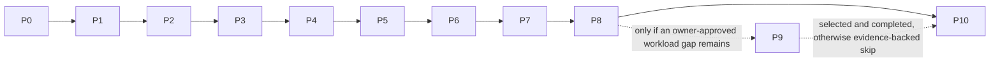

# Ternuxx roadmap

This roadmap defines the product sequence, acceptance gates, and safety boundaries. Ternuxx is independent from `soobujmiah/ternux`; the existing Debian rootfs and legacy launcher state remain separately owned. Ternuxx may reuse that rootfs for an explicitly started, uniquely tracked process/session, but never adopts or cleans up legacy/unknown processes. I explain what I want from Ternuxx in [What I want Ternuxx to become](PRODUCT-VISION.md). The roadmap below turns that into work we can verify phase by phase. Native and hybrid capabilities are additive: all useful, working Ternux PRoot capabilities must remain available, with no regression or forced migration.

## Live phase status

<!-- generated:phase-table:start -->
| ID | Phase | Status | Completed / skipped |
|---|---|---|---|
| P0 | Repository foundation and evidence baseline | completed | 2026-10-17 |
| P1 | Requirements and CPU/GPU/NPU compatibility research | completed | 2026-10-17 |
| P2 | Safe native desktop lifecycle | completed | 2026-10-18 |
| P3 | Doctor, management, and recovery | in_progress | — |
| P4 | Existing Ternux PRoot feature-parity provider | planned | — |
| P5 | Distro and display compatibility profiles | planned | — |
| P6 | CPU/GPU/NPU capability, optimization, and fallback | planned | — |
| P7 | Native apps and curated software catalog | planned | — |
| P8 | Hybrid workload and accelerator routing | planned | — |
| P9 | Optional isolated PRoot profile | planned | — |
| P10 | Hardening, release, and support | planned | — |
<!-- generated:phase-table:end -->

### Current serial work

<!-- generated:active-work:start -->
**Active phase:** P3 — Doctor, management, and recovery

**Next action:** Define preview/explicit-confirm/apply for Cron job create/update/remove in the shared service, then expose that exact contract across CLI, TUI, Web, and GTK. Continue remaining client parity before boot-helper reconciliation.

Complete this item and update its evidence before moving to the next item or phase.
<!-- generated:active-work:end -->

Phases are executed in the order shown above. P0–P2 are complete; P3 is the only active phase. The P3 ownership and fail-closed contract gates later providers; actual Ternux PRoot parity belongs to P4, and hybrid workload routing belongs to P8. The P3 reboot gate qualifies native startup only; PRoot and hybrid cold-boot checks follow their provider phases.

Phase state is recorded in [`project/phase-state.json`](../project/phase-state.json). After a gate is reviewed with evidence, use the phase workflow in [Phase documentation automation](#phase-by-phase-documentation-updates). Status rows above are generated; edit the roadmap gates below, not the generated table.

## Product outcomes

1. Build the pocket workstation I describe in [my vision](PRODUCT-VISION.md), with CPU workflows, verified GPU/NPU paths, and workload optimization that stays within Android thermal limits.
2. Make native Termux a first-class layer: run compatible tools directly in the Termux environment and investigate permitted Termux:API/Android integrations, without requiring a Linux guest for those tasks.
3. Keep the existing Ternux Debian PRoot as a first-class Linux layer for its current desktop, configured graphics path, audio/display behavior, and demonstrated workloads. Ternuxx integration is opt-in and must not silently replace, trim, upgrade, or remove it.
4. Combine both layers in Hybrid mode so users can use native/Android-facing workflows alongside the existing Linux and GPU-enabled PRoot workloads, with deliberate file and display/audio handoffs.
5. Report native and PRoot graphics and compute capability separately, using evidence from the actual workload process and backend.
6. Keep installation, storage estimates, compatibility/performance claims, and release status evidence-based. No accelerator or speedup is promised from hardware identification alone.

## P0 — Repository foundation and evidence baseline

**Goal:** establish project boundaries, accurate current-state documentation, and the phase evidence workflow.

**Deliverables:**
- Independent project identity, scope, architecture, safety rules, and owner context instructions.
- Evidence ledger separating native Termux, Debian PRoot, source review, and reported observations.
- Honest CLI/help/docs match implemented behavior, clearly disclose package/process mutations, and make no unsupported GPU claims. The help/source mismatch was corrected locally and guarded by a CLI contract test; runtime paths remain unqualified.
- Machine-readable phase state plus a generator for the README, roadmap status, and phase status page.
- License decision remains a release gate; do not invent license terms.

**Exit gate:**
- The owner approves project scope and the evidence/safety boundaries.
- `AI_ASSISTANT.md`, architecture, installation status, research, and roadmap agree with the source tree.
- Phase status can be regenerated from the state file, and a completion needs a repo-local evidence file with a passing gate record.
- No unrelated Ternux/device changes are included.

## P1 — Requirements and CPU/GPU/NPU compatibility research

**Depends on:** P0.

**Goal:** replace assumptions with a dated native-Termux capability matrix before package or lifecycle code is written.

**Deliverables:**
- Official Termux and Termux:X11 requirements, repository setup, package names, versions, dependency closure, and architecture captured with access date.
- Initial assessed baseline is Android 8+ for Termux:X11; this device profile is Android 16, `aarch64`, and Termux `0.119.0-beta.3`. Other Termux/Android combinations remain uncertified until tested.
- Required native commands, Termux:API boundaries, and minimum display-server requirements are defined; Android/API permissions remain user-controlled.
- Device capability matrix distinguishes Android OS, ABI, display server, audio service, CPU/ABI capabilities, GPU nodes, native Vulkan/OpenGL renderer, NPU hardware/runtime availability, and storage.
- CPU, GPU, and NPU software stacks are mapped by process context (Termux, Android app, or Debian PRoot); hardware marketing specifications are not treated as accessible runtime support.
- AI inference runtime candidates and current official vendor/delegate support are researched. Android NNAPI is not selected as a new foundation because Android documents its deprecation in Android 15; current alternatives and app-context constraints are evaluated.
- Native GUI apps, AI workloads, and Linux-only workloads classified by runtime, libc, accelerator, and model/operator needs.
- Package source/provenance policy; optional third-party repositories are off by default.

**Exit gate:**
- Every base-desktop install candidate is present in the dated official Termux indexes and has a reviewed simulated dependency plan; optional app packages have dated candidate/source records.
- Unsupported and unverified device behavior is marked as such, including whether NPU access is possible from Termux shell, Android app integration, or PRoot.
- A no-install research report and acceptance checklist are recorded; candidate NPU runtime licensing, distribution, ABI, and required Android integration are documented as open checks where unresolved.

**Non-goal:** installing packages or opening/stopping a desktop to gather research evidence.

## P2 — Safe native desktop lifecycle

**Depends on:** P1.

**Goal:** install and manage a native Termux XFCE session without taking ownership of unrelated X11/audio processes.

**Deliverables:**
- Preview-first native package installer with explicit confirmation and clear rollback information.
- Session state stored only under Ternuxx-owned paths.
- Display allocator checks socket and live-server state and refuses ambiguous conflicts.
- Start waits for server readiness, starts only needed owned services, then starts XFCE.
- Clear status and service-management commands report owner, display, and conflicts; only validated Ternuxx-owned processes are eligible for stop/restart.
- Failure rollback and stop act only on recorded, validated Ternuxx-owned process identities and sockets; no broad `pkill` or wildcard socket deletion.
- `status`, `doctor`, JSON output, and errors reflect actual state.
- Interrupted startup records enough state for the P3 recovery workflow; it never runs broad cleanup.
- Initial source implementation is recorded in [P2 lifecycle progress](evidence/P2-lifecycle-progress.md); this is source-review progress, not runtime acceptance.

**Exit gate:**
- Install preview matches the exact package transaction before consent.
- Start, repeated start, partial failure, stop, repeated stop, and unrelated-session preservation are verified.
- Physical-device evidence records Termux/X11 versions and display/audio outcomes.

## P3 — Doctor, management, and recovery

**Depends on:** P1 and the accepted P2 native lifecycle contract.

**Goal:** make shared management safe and understandable before Ternuxx takes ownership of any existing Ternux guest operation. One typed service/API is the source of truth for CLI, TUI, Web, and GTK. Every supported user-facing operation must be reachable from each client unless a documented technical/security boundary is owner-accepted; each client must show its real action support and use the same authorization, preview, journal, and result contract.

**Deliverables, in order:**
1. Read-only Doctor, service/session inventory, stable finding IDs, ownership proofs, and JSON/human output. Unknown or ambiguous state stays unknown and blocks mutation.
2. Define and fixture-verify the ownership contract for interactive PRoot TTY sessions: host PID/start identity, guest UID, working directory, argv/environment, attach/detach behavior, output, and exactly which process Ternuxx may signal. This phase establishes the contract; PRoot session implementation and live guest qualification remain in P4.
3. Serialized, journaled operations with exact preview, explicit confirmation, bounded rollback, and recovery for Ternuxx-owned files/services/processes only. Existing Ternux processes and broad legacy cleanup remain outside Ternuxx ownership.
4. Shared-management contract and a checked CLI/TUI/Web/GTK capability matrix for diagnostics, logs, monitoring, supported service/session controls, and recovery. Every supported user-facing action promised across clients is reachable through the shared service in CLI, TUI, Web, and GTK, or has a documented and owner-accepted client-specific limitation. Do not silently treat CLI-only behavior as complete shared management. A catalog listing alone does not count as an action.
5. Reconcile installed boot/recovery helper copies with repository source through an exact diff, state-preserving preview, backup, explicit apply, and tested rollback. Preserve the running Native `:1`, SSH 8022, managed 8023, and current Debian guest.
6. Define Native, existing-PRoot, Hybrid, and CLI-only boot profiles and their owner controls. In P3, only Native boot behavior may be qualified. PRoot launch/start remains gated by P4 and end-to-end Hybrid boot by P8; do not run legacy `x.sh` as a service command.
7. Verify Android startup/background behavior and Termux:Boot delivery, including retry/manual-open behavior, only in a separately authorized device-boot window. A manually invoked boot script is not cold-boot evidence. Never close the active Codex/Termux session as part of ordinary P3 work.
8. Run the P3 exit audit only after the prior items pass; report any owner-gated device check as open rather than inferring success.

**Current evidence:** owner visual review of GTK/TUI/Web/PRoot Apps is accepted. Cron's installed script is duplicate-safe when manually invoked, but cold-boot delivery is unqualified. Installed `00-ternuxx-services` and `ternuxx-recovery` differ from source and have no exact state-preserving deployment/rollback path yet. See [P3 boot/Cron recheck](evidence/2026-10-20-p3-owner-visual-and-boot-cron-recheck.md) and the [management client parity audit](evidence/2026-10-20-management-client-parity-audit.md).

**Exit gate:**
- Doctor is read-only and correct for missing, failed, unknown, stale, and conflicting states; ambiguous identities fail closed.
- Interactive PRoot TTY ownership rules are explicit and fixture-verified before P4 begins guest operations. Mutations are serialized, previewed, confirmed, journaled, operation-specific, and recoverable without touching unrelated Ternux/Android state.
- All supported user-facing management actions use one shared service contract across CLI, TUI, Web, and GTK, or have a documented, owner-accepted exception; the capability matrix and controls/help match reality.
- Installed boot/recovery entrypoints match source or have a documented, exact compatibility reason; their preview, apply, and rollback preserve user state.
- Native cold-boot/Android background behavior is verified in an authorized window before P3 can pass. If the owner does not authorize that window, keep P3 active and record the gate as owner-blocked; do not treat it as passed. PRoot and Hybrid boot acceptance remains deferred to P4/P8.
- Existing Native XFCE, SSH channels, Debian rootfs, and legacy launch workflows remain intact.

See [Doctor, management, and recovery](OPERATIONS.md), [shared management plan](architecture/SHARED-MANAGEMENT-PLAN.md), and [capability matrix](architecture/CAPABILITY-MATRIX.md) for operation contracts and client boundaries.

## P4 — Existing Ternux PRoot feature-parity provider

**Depends on:** P3 accepted ownership, operation-journal, and recovery contracts. P4 is the first phase that may implement and manage selected workloads in the existing Ternux Debian guest.

**Goal:** adapt Ternuxx to the already-working Debian installation while preserving the rootfs, package set, user data, legacy `db`/`droot`, `x.sh`, `xgo`, and `killx` workflows. Ternuxx manages only processes it starts and can identify; it never substitutes Termux Bionic libraries for Debian glibc libraries.

**Current evidence (not phase acceptance):** selected Debian apps and full XFCE have Ternuxx routes. Standalone `:0` requires Native XFCE `:1` stopped; nested full desktop uses Xephyr `:2` inside the active Native `:1`; individual PRoot app shortcuts route to `:1`. Direct Debian GLX on `:1` drew with Zink/Turnip. Nested `:2` only has a Zink/Turnip GLES context so far: DRI3 is unavailable and tested GLX draw produced zero frames. Fresh guest setup is fixture-tested, not replayed on a disposable guest. See [PRoot full GUI evidence](evidence/2026-10-20-proot-full-gui.md), [graphics recheck](evidence/2026-10-20-graphics-live-recheck.md), and [fresh reproducibility evidence](evidence/2026-10-20-proot-fresh-reproducibility.md).

**Deliverables:**
- Source and live capability inventory for the existing Ternux setup, including display/audio ownership, selected apps, package/profile identity, and actual graphics context.
- Read-only discovery and an argument-safe guest-command interface with verified distro/user/rootfs identity, scoped environment, output, exit status, and process identity.
- Supported routes: standalone full Debian GUI on `:0` only while Native `:1` is stopped; selected guest applications on Native `:1`; nested full Debian GUI on Xephyr `:2` inside Native `:1`. Never start a second Termux:X11 Activity for the nested route.
- Preserve authenticated Native PulseAudio and the guest's configured Zink/Turnip route where that exact workload verifies it. Keep the Debian guest independent of Native Termux Bionic libraries.
- A preview-first, reproducible setup/config replay tested only on a separate disposable guest. The fresh path must positively refuse the existing rootfs; no current-rootfs reset, replacement, pruning, or speculative package mutation.
- Separate graphics statements for direct `:1`, standalone `:0`, and nested `:2`. A renderer string/context creation is not draw evidence; nested acceleration stays unqualified until the intended app renders visibly or returns measured frames.
- Ternuxx-owned stop/recovery affects only identity-verified processes it started. Never invoke Ternux cleanup or rewrite legacy launchers.

**Exit gate:**
- Selected previously working Debian workflows still run with no rootfs or user-data loss; exact preservation evidence exists.
- Guest command arguments, environment, exit code, output, display/audio route, and ownership are verified.
- Standalone, selected-app, and nested routes have separate results; GPU claims require a real draw in that route. Unsupported nested GLX/DRI3 remains labelled unavailable/partial.
- Disposable guest package/config replay is reproducible from checked-in manifests without touching current Debian.
- Preview, recovery, and rollback stay within the Ternuxx-owned exact target; existing `db`/`droot`, `x.sh`, `xgo`, and `killx` behavior is preserved.

## P5 — Distro and display compatibility profiles

**Depends on:** P4 accepted existing-Debian provider behavior.

**Goal:** define a small, evidence-backed compatibility profile for the actual supported target. Do not turn every distro, Android release, display server, or ABI into a release promise.

**Deliverables:**
- Versioned profile for this device/runtime: Android 16, `aarch64`, current Termux/Termux:X11, Native XFCE, and the owner-selected Debian Ternux provider. Record exact versions and date each time they are refreshed.
- Matrix fields for host OS/API, Termux version, ABI, provider/rootfs identity, display, audio, storage, graphics API/backend, and known limits.
- Explicitly label all other Android/Termux/distro/display combinations as candidate or untested until they pass the same profile gate.
- Keep existing Debian detection/reuse separate from any future isolated-distro installer. Preview exact package transactions, rootfs target, storage basis, and rollback before any install/remove action.

**Exit gate:**
- Every advertised combination has install/start/stop/recovery and display/audio evidence at its advertised scope.
- The current Debian provider is detected and reused; profile selection cannot reinstall or replace it.
- Untested combinations are not shown as supported one-click options. This phase does not require broad distro coverage.

## P6 — CPU/GPU/NPU capability, optimization, and fallback

**Depends on:** P4 provider evidence and P5's bounded supported profile.

**Goal:** discover only compatible graphics/compute backends, select the best verified backend for each workload/API, and preserve an honest CPU path when the application supports it. Native Termux and Debian results remain separate.

**Current evidence (not phase acceptance):** Native Adreno 825 OpenGL/GLES draws and a bounded Vulkan draw are recorded; OpenGL fallback probes `llvmpipe` then `softpipe`. Direct Debian GLX on `:1` draws with Zink/Turnip. Ordinary app-launch fallback, clean-install Native provider reproduction, and nested `:2` presentation remain unqualified. NPU runtime/workload access is not verified. See [shared graphics evidence](evidence/2026-10-20-shared-graphics-manager.md), [Native GL benchmark](evidence/2026-10-20-native-offscreen-glmark2.md), [Vulkan draw](evidence/2026-10-20-native-vulkan-draw.md), [GLES draw](evidence/2026-10-20-native-gles-draw.md), and [PRoot graphics recheck](evidence/2026-10-20-graphics-live-recheck.md).

**Deliverables:**
- One shared graphics manager used by CLI, TUI, Web, and GTK: discovery, capability result, backend preference, workload/API requirement, logs, health check, and safe recovery have consistent semantics.
- Hardware-aware setup is reproducible from the Native installer and Debian profile. Device detection may select only an installed, compatible, verified backend; package presence or a renderer string alone is not acceleration proof.
- Per-workload/API backend order and explicit user preference. Never claim success by switching a Vulkan-only task to OpenGL, or vice versa.
- Real workload draw/presentation checks for each claimed Native or Debian route, with renderer/API/version and whether output was actually produced.
- Bounded fallback tries compatible verified alternatives without retry loops, then CPU (`llvmpipe`, or `softpipe` where suitable) only for workloads that support that API/software path. Report selected backend, failure reasons, and output/result validation.
- Named CPU and GPU benchmark/workload comparisons with correctness, latency/throughput, memory, thermal/battery state, and a restore path. Preserve stable CPU operation as the baseline.
- Assess NPU hardware, accessible runtime/delegate, ABI, supported operators, licensing, and a real named workload. If no callable supported path exists, record NPU as unavailable/unverified; NPU availability is not a completion prerequisite.
- Optimization controls only where the app/runtime supports them; no thermal bypass, guessed affinity, or forced system tuning.

**Exit gate:**
- The same workload reports its actual API/backend/result separately in Native, direct Debian, standalone `:0`, and nested `:2` where those routes are claimed.
- API-incompatible alternatives are rejected; deliberate safe failure reaches the next compatible backend and then a working CPU path when supported.
- Clean-install setup recreates the selected profile and its fallback without borrowing Bionic libraries inside Debian.
- NPU is either workload-verified or explicitly unavailable/unverified. Renderer/context creation without output is not a pass.

## P7 — Native apps and curated software catalog

**Depends on:** P5 supported profiles and P6 capability/fallback contracts.

**Goal:** provide a small useful catalog of official, currently supported software with clear provider requirements and safe lifecycle actions.

**Deliverables:**
- One catalog/action contract shared by CLI, TUI, Web, and GTK for core browsing, search, provider, package details, preview, consent, progress, result, update, and remove status. Each client accurately exposes its supported actions.
- Begin with a bounded set of owner-selected apps used by the supported Native/PRoot workflows. Every entry has official publisher/source, version/review date, ABI/provider, display/audio needs, dependencies, and known limits.
- Preview exact install/update/remove effects and package-manager transaction where available. Optional apps stay out of the base desktop install; removal cannot remove core packages or touch existing Debian unless an exact, separately previewed guest operation explicitly targets a disposable guest.
- Website catalog links to publishers/docs and guides users to Ternuxx-managed preview or official instructions; no opaque remote shell installers.
- Add Termux:API or AI/software entries only after verifying current official package/runtime availability and the actual required permissions, workload, operators, provenance, and backend.

**Exit gate:**
- Every advertised app has source and provider evidence plus install/start/exit/update/remove or a clearly documented unsupported lifecycle action.
- CLI, TUI, Web, and GTK do not show dead actions; supported core catalog actions use the shared service and matching preview/consent semantics.
- Catalog and package metadata are rechecked for the release; stale entries are marked unavailable or removed.

## P8 — Hybrid workload and accelerator routing

**Depends on:** P3 shared management, P4 Debian provider, P5 supported profile, P6 graphics/CPU fallback, and P7 catalog contracts.

**Goal:** prove Native, existing-PRoot, and Hybrid workflows end to end while keeping process, display/audio, storage, and accelerator ownership explicit.

**Deliverables:**
- Per-app/workload registry selects provider, required API, graphics preference, fallback policy, working directory, safe argv, and allowlisted environment. Show the route before first launch.
- Native-only boot/workload/result flow; standalone PRoot `:0` flow while Native GUI is stopped; Hybrid flow with Native `:1`, individual guest app shortcuts on `:1`, and optional nested full desktop on `:2`.
- Record boot profile, logs, recovery, process identity, result path, exit/signal, and output artifact through the shared management service and all supported clients.
- Deliberate file handoff only through explicitly selected workspace paths; no blanket home/config/SSH/shared-storage mounts.
- Explicit display/audio conflict checks and one owner per display/service. No automatic accelerator or provider switch when the route cannot be proven.
- Prove PRoot/Hybrid boot only after P4 ownership and P3 Native boot controls are accepted; do not use legacy global cleanup.

**Exit gate:**
- Demonstrate boot-to-workload-to-result for Native-only, standalone PRoot-only, and Hybrid on the supported profile.
- Hybrid safely launches a selected Debian app in Native XFCE and nested full desktop where supported; nested GPU status reflects measured presentation, not context strings.
- CLI/TUI/Web/GTK report consistent provider/backend/result and the actions they can perform; failures stop safely with actionable diagnostics.
- Existing Ternux workflows and rootfs remain intact.

## P9 — Optional isolated PRoot profile (only for a proven gap)

**Depends on:** P4 and P8. Optional: enter this phase only if an owner-approved workload gap cannot be served by Native Termux or the existing Debian setup.

**Goal:** add a separate reproducible profile only for a demonstrated need. It must never replace or minimize the existing Ternux Debian installation.

**Deliverables if selected:**
- Separate rootfs identity, ownership/backup/removal contract, versioned workload-based manifest, exact transaction preview, free-space check, interruption recovery, and tested rollback/removal on a disposable profile.
- Measured installed size and named workload result; no estimates represented as measured facts.
- Positive guards proving every mutating action targets only the new rootfs.

**Exit gate if selected:** install, recovery, workload, and removal pass on a disposable profile with identity checks and evidence. If no approved gap remains, when P9 becomes active create a separate evidence record with `Gate: SKIP`, acceptance criteria, and evidence; use `python3 tools/phase_docs.py skip P9 ...` to advance. Do not mark it skipped early or use the existing Debian rootfs as its test target.

## P10 — Hardening, release, and support

**Depends on:** all required phases P0–P8 and any explicitly selected P9 work. P9 must be evidence-skipped if it is not selected.

**Goal:** make the supported Ternuxx profile reproducible, understandable, recoverable, and supportable. Separate internal project completion from public release readiness.

**Deliverables:**
- Full CI/static/unit/fixture gates for ownership, argv, package previews, recovery/rollback, graphics API boundaries, client parity, generated docs, and install reproducibility. Physical-device evidence remains separate from CI.
- Fresh-install/replay guide for Native Termux and the supported Debian setup, including exact package/config versions, device selection rules, upgrade, rollback, backup, recovery, and uninstall. Never overwrite current Debian in the reproduction procedure.
- Compatibility matrix, supported/unsupported routes, known issues, troubleshooting, user-facing CLI/TUI/Web/GTK help, and phase/roadmap docs agree with the implementation and evidence.
- Security/provenance review for package sources, downloaded drivers, permissions, local services, data paths, and recovery artifacts. No private device state or credentials in CI/evidence.
- License remains unresolved until the owner selects a license. Public release/contributions require the owner-selected license and complete third-party notices/provenance; internal project completion can be reported separately while public release remains blocked.
- Refresh deterministic repository state through the project/SKB workflow without hand-editing generated state.

**Exit gate:**
- All required phase gates and automated checks pass; the supported target can be reproduced from repository instructions and rollback is demonstrated.
- No unsupported GPU/NPU, boot, compatibility, or client-action claim remains in docs or UI.
- Release scope, support boundaries, license, and provenance are explicit. If license remains unresolved, report project implementation complete but public release not ready; do not publish a release.

## Phase-by-phase documentation updates

`project/phase-state.json` is the source of phase status. The generator updates the status block in this roadmap, the README summary, and `docs/PHASE-STATUS.md` together.

```bash
# Rebuild generated status from the recorded state; safe to run repeatedly.
python3 tools/phase_docs.py refresh

# Record preparatory evidence for a still-planned later phase without activating or completing it.
python3 tools/phase_docs.py annotate P4 --evidence docs/evidence/2026-10-20-phase-roadmap-audit.md --summary "P4 is prepared only; nested presentation and disposable guest replay remain open."
python3 tools/phase_docs.py annotate P9 --optional --evidence docs/evidence/2026-10-20-phase-roadmap-audit.md --summary "Optional profile; no workload gap selected."

# Only after P9 becomes the active phase, record a separately reviewed skip:
python3 tools/phase_docs.py skip P9 --evidence docs/evidence/P9-optional-skip.md --summary "No owner-approved workload gap remains."

# Update verified progress and the next action for the active phase.
python3 tools/phase_docs.py update P3 --evidence docs/evidence/example-p3-progress.md --summary "Current evidence-backed progress." --next-action "Next bounded acceptance action."

# After reviewing a gate, create an evidence file from the [completion template](evidence/PHASE-COMPLETION-TEMPLATE.md) and record completion.
python3 tools/phase_docs.py complete P0 --evidence docs/evidence/P0-foundation.md --summary "Foundation gate passed; evidence and owner review recorded."
```

Completion is an explicit reviewed transition, never inferred from a commit or checklist alone. A completion requires a repo-local evidence document with Gate: PASS, Acceptance criteria, and Evidence sections; it completes only the active phase and activates the next planned phase. Update records active-phase progress; annotate records preparation without changing order. Annotate with optional metadata marks a planned phase skippable. Once active, skip requires a separate evidence record with Gate: SKIP, Acceptance criteria, and Evidence, then advances to the next planned phase. A skip is not a completion. The state loader rejects out-of-order statuses and skips of required phases. Evidence paths stay inside the repository and identify the phase. The tool does not commit or push. Refresh restores generated views from the phase state.

## Shared Management Center status (P3 submilestone)

GTK, TUI, Web, and CLI use the shared management service for the operations each exposes. Owner visual acceptance for the installed GTK/TUI/Web and Native XFCE PRoot Apps menu was recorded on 2026-10-20; do not list visual launch as pending. The per-client operation gaps remain in [the capability matrix](architecture/CAPABILITY-MATRIX.md), and the dated parity audit is an implementation snapshot, not final acceptance. P3 must close the agreed core management/recovery contract and keep unsupported actions visibly unavailable. Catalog install/update/remove parity belongs to P7; end-to-end Native/PRoot/Hybrid app and workload flows belong to P8. Do not create a separate phase or start future-phase implementation while P3 is active.

## Dependency order



Only one phase is active. Within it, work follows the numbered deliverables and its exit gate; later-phase notes are planning only. P3 proves shared ownership and recovery; P4 adapts the existing Ternux Debian; P5 fixes the supported profile; P6 verifies accelerators and API-safe CPU fallback; P7 delivers the supported catalog; P8 proves cross-layer workflows. P9 is optional and cannot be skipped until its position in sequence is reached. P10 closes project reproducibility and support. An evidence-backed optional skip resolves P9 without claiming its implementation.

**Definition of project completion:** the selected supported target can reproduce the Native, existing Debian PRoot, and Hybrid workflows through Ternuxx-managed configuration; core supported actions are accurately exposed through the shared CLI/TUI/Web/GTK contracts; claimed graphics paths render in named workloads and compatible CPU fallback works where the workload supports it; recovery, tests, docs, and rollback match the shipped behavior; unsupported features such as inaccessible NPU paths are reported honestly. Broad device/distro certification, unselected P9 work, and optional Wine/Hangover workflows are outside this definition unless explicitly selected. Public release additionally needs owner-selected license and complete provenance.
