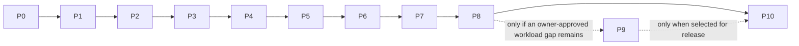

# Ternuxx roadmap

This roadmap defines the product sequence, acceptance gates, and safety boundaries. Ternuxx is independent from `soobujmiah/ternux`; its existing Debian rootfs, launcher, processes, and state are never Ternuxx-owned by default. I explain what I want from Ternuxx in [What I want Ternuxx to become](PRODUCT-VISION.md). The roadmap below turns that into work we can verify phase by phase. Native and hybrid capabilities are additive: all useful, working Ternux PRoot capabilities must remain available, with no regression or forced migration.

## Live phase status

<!-- generated:phase-table:start -->
| ID | Phase | Status | Completed |
|---|---|---|---|
| P0 | Repository foundation and evidence baseline | completed | 2026-10-17 |
| P1 | Requirements and CPU/GPU/NPU compatibility research | completed | 2026-10-17 |
| P2 | Safe native desktop lifecycle | completed | 2026-10-18 |
| P3 | Doctor, management, and recovery | in_progress | — |
| P4 | Existing Ternux PRoot feature-parity provider | planned | — |
| P5 | Distro and display compatibility profiles | planned | — |
| P6 | CPU/GPU/NPU capability, optimization, and fallback | planned | — |
| P7 | Native apps and curated software catalog | planned | — |
| P8 | Hybrid workload and accelerator routing | planned | — |
| P9 | Optional isolated PRoot profile | planned | — |
| P10 | Hardening, release, and support | planned | — |
<!-- generated:phase-table:end -->

### Current serial work

<!-- generated:active-work:start -->
**Active phase:** P3 — Doctor, management, and recovery

**Next action:** Continue P3 native ownership/recovery gates and finish the shared management read-only Web/X11 client/session bootstrap. Next PRoot work must adapt and verify installed Debian first; selective distro and desktop lifecycle adapters follow behind preview, explicit confirmation, and recovery gates.

Complete this item and update its evidence before moving to the next item or phase.
<!-- generated:active-work:end -->

Phases are executed in the order shown above. P0–P2 are complete; P3 is the only active phase. The P3 ownership and fail-closed contract gates later providers; actual Ternux PRoot parity belongs to P4, and hybrid workload routing belongs to P8. The P3 reboot gate qualifies native startup only; PRoot and hybrid cold-boot checks follow their provider phases.

Phase state is recorded in [`project/phase-state.json`](../project/phase-state.json). After a gate is reviewed with evidence, use the phase workflow in [Phase documentation automation](#phase-by-phase-documentation-updates). Status rows above are generated; edit the roadmap gates below, not the generated table.

## Product outcomes

1. Build the pocket workstation I describe in [my vision](PRODUCT-VISION.md), with CPU workflows, verified GPU/NPU paths, and workload optimization that stays within Android thermal limits.
2. Make native Termux a first-class layer: run compatible tools directly in the Termux environment and investigate permitted Termux:API/Android integrations, without requiring a Linux guest for those tasks.
3. Keep the existing Ternux Debian PRoot as a first-class Linux layer for its current desktop, configured graphics path, audio/display behavior, and demonstrated workloads. Ternuxx integration is opt-in and must not silently replace, trim, upgrade, or remove it.
4. Combine both layers in Hybrid mode so users can use native/Android-facing workflows alongside the existing Linux and GPU-enabled PRoot workloads, with deliberate file and display/audio handoffs.
5. Report native and PRoot graphics and compute capability separately, using evidence from the actual workload process and backend.
6. Keep installation, storage estimates, compatibility/performance claims, and release status evidence-based. No accelerator or speedup is promised from hardware identification alone.

## P0 — Repository foundation and evidence baseline

**Goal:** establish project boundaries, accurate current-state documentation, and the phase evidence workflow.

**Deliverables:**
- Independent project identity, scope, architecture, safety rules, and owner context instructions.
- Evidence ledger separating native Termux, Debian PRoot, source review, and reported observations.
- Honest CLI/help/docs match implemented behavior, clearly disclose package/process mutations, and make no unsupported GPU claims. The help/source mismatch was corrected locally and guarded by a CLI contract test; runtime paths remain unqualified.
- Machine-readable phase state plus a generator for the README, roadmap status, and phase status page.
- License decision remains a release gate; do not invent license terms.

**Exit gate:**
- The owner approves project scope and the evidence/safety boundaries.
- `AI_ASSISTANT.md`, architecture, installation status, research, and roadmap agree with the source tree.
- Phase status can be regenerated from the state file, and a completion needs a repo-local evidence file with a passing gate record.
- No unrelated Ternux/device changes are included.

## P1 — Requirements and CPU/GPU/NPU compatibility research

**Depends on:** P0.

**Goal:** replace assumptions with a dated native-Termux capability matrix before package or lifecycle code is written.

**Deliverables:**
- Official Termux and Termux:X11 requirements, repository setup, package names, versions, dependency closure, and architecture captured with access date.
- Initial assessed baseline is Android 8+ for Termux:X11; this device profile is Android 16, `aarch64`, and Termux `0.119.0-beta.3`. Other Termux/Android combinations remain uncertified until tested.
- Required native commands, Termux:API boundaries, and minimum display-server requirements are defined; Android/API permissions remain user-controlled.
- Device capability matrix distinguishes Android OS, ABI, display server, audio service, CPU/ABI capabilities, GPU nodes, native Vulkan/OpenGL renderer, NPU hardware/runtime availability, and storage.
- CPU, GPU, and NPU software stacks are mapped by process context (Termux, Android app, or Debian PRoot); hardware marketing specifications are not treated as accessible runtime support.
- AI inference runtime candidates and current official vendor/delegate support are researched. Android NNAPI is not selected as a new foundation because Android documents its deprecation in Android 15; current alternatives and app-context constraints are evaluated.
- Native GUI apps, AI workloads, and Linux-only workloads classified by runtime, libc, accelerator, and model/operator needs.
- Package source/provenance policy; optional third-party repositories are off by default.

**Exit gate:**
- Every base-desktop install candidate is present in the dated official Termux indexes and has a reviewed simulated dependency plan; optional app packages have dated candidate/source records.
- Unsupported and unverified device behavior is marked as such, including whether NPU access is possible from Termux shell, Android app integration, or PRoot.
- A no-install research report and acceptance checklist are recorded; candidate NPU runtime licensing, distribution, ABI, and required Android integration are documented as open checks where unresolved.

**Non-goal:** installing packages or opening/stopping a desktop to gather research evidence.

## P2 — Safe native desktop lifecycle

**Depends on:** P1.

**Goal:** install and manage a native Termux XFCE session without taking ownership of unrelated X11/audio processes.

**Deliverables:**
- Preview-first native package installer with explicit confirmation and clear rollback information.
- Session state stored only under Ternuxx-owned paths.
- Display allocator checks socket and live-server state and refuses ambiguous conflicts.
- Start waits for server readiness, starts only needed owned services, then starts XFCE.
- Clear status and service-management commands report owner, display, and conflicts; only validated Ternuxx-owned processes are eligible for stop/restart.
- Failure rollback and stop act only on recorded, validated Ternuxx-owned process identities and sockets; no broad `pkill` or wildcard socket deletion.
- `status`, `doctor`, JSON output, and errors reflect actual state.
- Interrupted startup records enough state for the P3 recovery workflow; it never runs broad cleanup.
- Initial source implementation is recorded in [P2 lifecycle progress](evidence/P2-lifecycle-progress.md); this is source-review progress, not runtime acceptance.

**Exit gate:**
- Install preview matches the exact package transaction before consent.
- Start, repeated start, partial failure, stop, repeated stop, and unrelated-session preservation are verified.
- Physical-device evidence records Termux/X11 versions and display/audio outcomes.

## P3 — Doctor, management, and recovery

**Depends on:** P1; management can be specified while P2 lifecycle implementation continues.

**Goal:** provide a professional, read-only diagnostic system and safe control/recovery model for Ternuxx-owned operations.

**Deliverables:**
- Read-only Doctor with severity, stable finding IDs, source/scope, suggested action, and human plus JSON output.
- Service/session inventory that distinguishes Ternuxx-owned processes from external Termux, Android, and existing Ternux processes.
- Ownership records that validate PID start time, executable, session, display, and state paths before management actions.
- Operation serialization and a durable journal written before mutations; interrupted steps are reported for explicit recovery.
- Owner-controlled Termux:Boot profiles for native, PRoot, hybrid, and CLI-only modes; preview generated script and expose profile/status/enable/disable CLI controls. Native starts native XFCE; PRoot starts the existing Debian guest via an ownership-aware adapter; hybrid starts one native XFCE and routes selected guest workloads to that display. Request the X11 Android activity and report GUI visibility separately from service readiness.
- The fixed native SSH Runit unit now has CLI preview/apply start/stop with exact checked-out/installed run-script identity, exact sv target, pre-action journal, and post-action status verification; other service managers remain unselected and listener process ownership is still unverified.
- Interrupted SSH service, native boot-profile, native desktop-session, backup-create, and profile restore/rollback operations can now be reconciled through exact-preview, explicit-confirmation CLI paths. Each preview lists the exact journal paths it may update; service, boot, session, profile, and archive state are inspection-only. Desktop recovery refuses active locks or ambiguous states and never signals processes. Unsupported recovery kinds remain open; see [recovery evidence](evidence/2026-10-18-desktop-session-recovery.json) and [Doctor progress](evidence/P3-doctor-progress.md).
- `proot status` exposes the read-only installed-guest inventory through the shared management API. It explicitly reports guest ownership as unverified and never enters Debian; provider launch/control still requires the P3/P4 ownership contract.
- A fixed-unit native SSH service lifecycle slice is implemented for CLI preview/apply. SSH setup/migration, authenticated health after action, separate PRoot provider controls, Web/X11 parity, and device mutation qualification remain pending. Follow the [SSH lifecycle contract](architecture/SSH-LIFECYCLE.md).
- PRoot auto-start preserves the existing Ternux Zink/Turnip environment and never invokes the current `~/x.sh` as a boot command, because its cleanup is global and can terminate native or unrelated sessions. Use a separate adapter that owns only the processes it started.
- Optional Shizuku provider health/status integration; ADB-over-Wi-Fi auto-start is a separate, off-by-default advanced capability requiring exact transport/security review and explicit consent. Native desktop boot has no Shizuku dependency.
- Doctor probes only local ADB server `host:version` on `127.0.0.1:5037` without starting the server or querying devices; it reports that signal separately from Wireless Debugging, device authorization, and Shizuku service/watchdog state.
- The optional management HTTP/TCP source stack now includes typed authenticated adapter dispatch, private durable mutation idempotency/audit, and `ternuxx management http serve`: an explicit foreground, read-only runtime with a per-run TTY-delivered bootstrap secret and `127.0.0.1` listener with bounded workers/requests and graceful drain. It is not connected to the boot/service lifecycle, does not start automatically, and has only ephemeral loopback fixture evidence; browser, device fixed-port, and selected private-remote-transport checks remain open. Mutation transport remains off.
- Keep management HTTP, PRoot ADB `5037`, Android Wireless Debugging, and native SSH on distinct ports and ownership contracts. The dated ADT audit documents one custom-Shizuku bootstrapped topology plus standard Wireless Debugging as a manual-pairing alternative after reboot; neither is current Ternuxx runtime qualification.
- Ternuxx-only configuration backup, integrity inspection, restore preview, rollback snapshot, and explicit restore/rollback confirmation.
- The source-backed [dependency and capability fallback matrix](DEPENDENCY-FALLBACK-MATRIX.md) distinguishes package/app presence, service readiness, provider ownership, renderer context, and no-switch fallback behavior for Termux:Boot, Runit, Termux:X11/XFCE, PRoot/GPU, Shizuku, and Termux:API. It documents current source behavior; it does not complete device qualification.
- No fix-all, broad process killing, generic cleanup, PRoot pruning, or repair of Ternux-owned state.

**Exit gate:**
- Doctor is demonstrably read-only and accurately reports missing, failed, unknown, and conflicting states.
- Missing optional dependencies produce an explicit lower-capability fallback, never a silent provider switch or success claim.
- Stale PID, unexpected process exit, interrupted operation, corrupt backup, path traversal, and external display conflict cases fail closed.
- Until the corresponding provider phase is accepted, PRoot and hybrid launch requests fail closed and never fall back to another provider. PRoot parity is gated by P4; hybrid routing is gated by P8.
- On a disposable test profile or with explicit owner authorization, verify native cold boot/retry; verify CLI service start, X server start, GUI activity request, Android background restrictions, and manual-open fallback. An accepted activity request is not proof of visible GUI. PRoot boot follows P4, and hybrid boot follows P8.
- Shizuku provider is distinguished from upstream support and any custom build; no ADB Wi-Fi listener is enabled by default, and a failed watchdog stops after bounded retries.
- Recovery preview identifies every affected path; restore and rollback affect only a disposable Ternuxx state fixture and preserve the existing Ternux setup.

See [Doctor, management, and recovery](OPERATIONS.md) for command and safety contracts, including optional Termux:Boot and Termux:API use.

## P4 — Existing Ternux PRoot feature-parity provider

**Depends on:** P1 and the accepted P3 ownership contract. This is the first phase that may implement an ownership-aware adapter for the existing Ternux guest.

**Goal:** let users opt into the existing Ternux Debian environment without losing any working Ternux capability. Preserve feature parity with its established desktop and workloads, including its configured Zink/Turnip GPU route where the live renderer confirms it, while leaving lifecycle and rootfs ownership with Ternux.

**Deliverables:**
- Source-reviewed capability/behavior matrix of the existing Ternux setup: desktop/session, display/audio, configured graphics backend, and owner-demonstrated Linux workloads. The pinned source baseline is recorded in [P4 Ternux source and capability matrix](evidence/P4-ternux-source-capability-matrix-2026-10-18.md); this is not yet a live parity qualification.
- Read-only detection of distro, guest user, backend, active display, and Ternux-managed environment.
- Explicit guest-command interface with argument-safe execution; no shell-string evaluation of user input.
- Preserve the existing Ternux launch environment and configured Zink/Turnip or VirGL path; do not substitute a different backend or silently reduce capabilities. Record GPU rendering from the live workload context.
- Keep CPU execution available as the baseline; do not imply PRoot can access an Android NPU. NPU use requires a separately proven runtime/integration path.
- Refuse missing/ambiguous setup, absent active display, or display/audio ownership conflicts.
- Provide a separate Ternuxx-owned PRoot start adapter using the reviewed Ternux environment. Do not use `~/x.sh` as a service/boot entry because its broad cleanup would terminate unrelated sessions. Never call Ternux stop/cleanup; never rewrite `~/x.sh`; never install/upgrade/remove packages or prune the existing rootfs.
- Ternuxx status says whether it invoked a guest workload; Ternux remains owner of desktop lifecycle.

**Exit gate:**
- Read-only discovery matches current Ternux source/configuration.
- The integration's behavior matrix demonstrates that existing Ternux desktop, display/audio lifecycle, configured graphics route, and selected previously working workloads remain available; no capability regression is introduced.
- A selected command runs in the intended existing guest and preserves arguments, environment boundaries, exit status, and output.
- Live guest renderer is recorded from the same display/process context; `llvmpipe` is reported as software rendering.
- Owner-approved device evidence confirms no Ternux cleanup, rootfs mutation, or unrelated process termination.

## P5 — Distro and display compatibility profiles

**Depends on:** P3 and P4; existing Ternux Debian remains the first Linux provider and defines the initial compatibility baseline.

**Goal:** let users choose from clearly scoped Linux distribution and display profiles without claiming that package-manager support alone proves desktop or accelerator compatibility.

**Deliverables:**
- A provider interface for the existing Ternux Debian setup and any later isolated distro profile.
- Compatibility matrix for candidate distributions, Android/Termux versions, ABI, desktop, display backend, audio, storage, and accelerator path.
- Termux:X11 is the initial supported native desktop backend. Other display options such as VNC or Wayland remain candidates until tested against the exact device and provider.
- Distro selection and install/remove actions show provider, rootfs identity, storage estimate source, and exact transaction preview.
- Existing Ternux Debian is detected and reused; it is never reinstalled, minimized, or replaced by a distro selector.

**Exit gate:**
- Every advertised distro/display pairing has install/start/stop/recovery evidence and explicit limitations.
- Unsupported or untested pairings remain labeled candidates and are not exposed as one-click supported choices.

## P6 — CPU/GPU/NPU capability, optimization, and fallback

**Depends on:** P1, P2, P4, and P5.

**Goal:** establish truthful CPU, GPU, and NPU capability tiers for each supported device and process context, then optimize measured workloads sustainably and provide useful CPU fallback when accelerators are unavailable. Candidate backends are discovered, not assumed.

**Free-core rule:** CPU inference and dependable fallback, supported GPU/NPU inference, essential diagnostics, and basic reproduction of published tests remain free-core capabilities. This is a product policy, not a statement that an inference runtime currently exists. Current evidence and status are in [testing and acceleration](testing/README.md).

**Deliverables:**
- CPU inference is the first free-core runtime target, with a dependable fallback and workload-specific performance/thermal limits documented. It is not implemented until a runtime/model passes the gate.
- Read-only native Vulkan probe and live native OpenGL renderer evidence when an appropriate tool is available; GPU capability remains separate per native and PRoot process context.
- Driver/version/device result recorded separately from the PRoot provider result. Renderer states include verified hardware Zink/Turnip, VirGL, software (`llvmpipe`), unavailable, and unknown.
- NPU feasibility gate identifies exact device/SoC, accessible vendor runtime/delegate, supported model operators/quantization, ABI, licensing, Android integration needs, and whether the runtime is callable from Termux or PRoot. NNAPI deprecation is accounted for; no Android NPU access is assumed from a shell or guest.
- Desktop/workloads never claim accelerator use based on device nodes, ICD files, successful instance creation, package presence, or cache contents.
- Fallback behavior is explicit and observable: selected backend, reason for fallback, and CPU limits are reported.
- Workload profiles for efficiency, balanced, sustained, and custom settings; provider-aware thread, memory, render, and model controls only where the application supports them.
- Native Wine/Hangover is treated as an optional application runtime: validate its current official Termux package set, architectures, per-app compatibility, native display/audio, OpenGL and Vulkan paths, and CPU/thermal behavior. Native DXVK is blocked until the native Vulkan driver passes capability checks and a real workload renders correctly.
- NPU is not implied by Wine/Hangover or by Android services. A named Android-side runtime/bridge and named inference workload are required; NNAPI deprecation is accounted for.
- Thermal/battery/memory telemetry is sourced from supported APIs and is labeled unavailable when absent; long-running workloads can reduce per-job concurrency or quality through an owner-enabled policy.
- Storage/cache analysis reports exact owner and paths, with previewed cleanup restricted to Ternuxx-owned regenerable data.
- No governor/clock/thermal-protection bypass, guessed CPU affinity, hidden persistent wake lock, or Ternux rootfs cleanup.

**Exit gate:**
- CPU, GPU, and (if accessible) NPU capability are measured on each supported device profile and reported per execution context.
- Any NPU backend passes a real workload test showing the selected runtime/delegate; otherwise NPU is marked unavailable or unverified and CPU/GPU fallback remains clear.
- Native Termux Turnip rejection and independent Ternux PRoot rendering results remain separately scoped to their tested versions and workloads.
- UI and workload paths do not silently label software rendering or CPU fallback as accelerator execution.
- Optimization profile results include a comparable baseline, workload correctness, sustained throughput/latency, memory, thermal/battery state, and a verified restore path.

## P7 — Free-core native apps and curated software catalog

**Depends on:** P2, P3, P5, and P6 so listings can state verified provider and capability limits.

**Goal:** offer a useful native workstation and a maintained website catalog of optional software, with compatibility and provenance clear before installation.

**Deliverables:**
- Free-core interactive CLI installer/catalog with categories, search, package details, provider selection, dependency/space preview where available, consent, progress, and actionable failure output. Optional premium additions must not gate essential install, diagnostics, recovery, acceleration, or evidence.
- Optional terminal, file manager, browser, editor, CLI, media, developer, and AI tools only after current official package/runtime verification.
- Website catalog entries link to official publishers and documentation, show supported layer/provider, ABI/runtime, display/audio needs, review date, and known limitations.
- The website guides users to the Ternuxx CLI or official publisher instructions; it does not serve opaque shell installers or run remote install scripts.
- Optional software can be installed, updated, and removed as individually previewed transactions; it is excluded from core desktop dependencies.
- Native integrations identify Termux:API companion/app needs and user-controlled Android permissions.
- Optional API integrations cover selected user-triggered Android workflows (for example file sharing, clipboard, notifications, or device status) only when supported by the installed API command and permission set.
- AI workflow records include model provenance/format, supported operators, quantization, actual delegate/backend, correctness, latency, throughput, memory, and thermal/power observations. Basic local benchmark reproduction and truthful reports remain free; only substantial optional batch orchestration/report services may be considered premium after demand evidence.

**Exit gate:**
- Every advertised app has a current official source, install/start/exit evidence, and known limitations.
- Catalog links and package metadata are rechecked during release; stale or unsupported listings are marked or removed.
- Optional app removal cannot remove base packages or touch the existing Ternux rootfs.

## P8 — Hybrid workload and accelerator routing

**Depends on:** P2, P3, P4, P5, P6, and P7.

**Goal:** make native Termux and existing Ternux PRoot work together end to end—from selected boot profile and app/provider choice through display/audio, files, workload execution, status, optimization, and recovery—while keeping each runtime and owner boundary explicit.

**Deliverables:**
- Explicit provider and accelerator selection in a per-app/workload registry; no inference from executable name, device spec sheet, or package presence.
- End-to-end boot profiles for native, PRoot, or hybrid; one desktop owner per display; service status, logs, and recovery records identify which adapter started each process.
- Provider-aware app/catalog install, command launch, selected file handoff, display/audio connection, result collection, Doctor findings, optimization status, and independent SSH service control from both CLI and GUI.
- Reusable workflow contract records argv, working directory, allowlisted environment, scoped workspace paths, provider, exit status, and output artifacts.
- Native processes handle compatible Termux/Android-facing tasks; the existing Debian guest remains available for Linux applications and its configured GPU workloads.
- Safe argv passing, working-directory policy, environment allowlist, exit-code/signal forwarding, and output behavior.
- Explicit display/audio handoff requirements, service ownership, and conflict checks.
- Shared file access limited to deliberate paths; no blanket `~/.ssh`, `~/.config`, or shared-storage mount.
- User-visible explanation of where a workload will run before first use.

**Exit gate:**
- Each layer remains useful independently, and combined workflows match the declared registry; existing Ternux workflows remain available with parity evidence.
- Demonstrate boot-to-workload-to-result flows for native-only, PRoot-only, and hybrid modes; hybrid shares one desktop lifecycle and safely hands a selected file and command to the guest.
- Failure to resolve a route fails closed and never silently switches provider or accelerator.

## P9 — Optional isolated PRoot profile (only for a proven gap)

**Depends on:** P4 and P8, and only proceeds if an owner-approved workload cannot use the existing Ternux rootfs. This phase is optional and is skipped when existing Ternux reuse is sufficient.

**Goal:** provide an isolated, reproducible PRoot profile only if a demonstrated workload gap cannot be served by native Termux or the full existing Ternux setup. This optional profile supplements; it never replaces or minimizes Ternux Debian.

**Deliverables:**
- Separate named rootfs and explicit ownership/backup/removal contract.
- Versioned manifest based on demonstrated workloads, not speculative packages.
- Existing Ternux rootfs is never the target of cleanup, autoremove, package pruning, size-reduction, replacement, or migration operations.
- Actual installed-size measurements after install and updates; no unmeasured storage promise.
- Preview, free-space check, interruption recovery, and explicit remove flow.

**Exit gate:**
- Rootfs identity is distinct from existing Ternux Debian and checked before every mutating operation.
- Any optional profile is additive and cannot be a dependency for existing Ternux desktop or GPU route.
- Install/recovery/remove are exercised on a disposable profile first.
- Storage and workload results are recorded.

## P10 — Hardening, release, and support

**Depends on:** all capabilities selected for release. P9 is included only if its optional isolated profile is selected.

**Goal:** make releases reproducible, supportable, and safe to maintain.

**Deliverables:**
- Integrate SKB deterministic repository-state tooling and the owner-approved pull-only registry flow; generated state stays tool-owned and private project facts are not publicly projected. Keep the phase documentation generator and `.repo/STATUS.md` as separate views.
- Maintain evidence-backed project and technical summaries in SKB through a session-level knowledge-return pass. Project CI must never hold SKB write credentials.

- Automated shell/static checks and focused tests for ownership, argument passing, state recovery, package previews, and generated documentation.
- CI runs without accessing private device state or shared storage.
- Compatibility matrix, supported/unsupported combinations, known issues, troubleshooting, upgrade, rollback, recovery, and uninstall docs.
- Owner-selected license and complete notices/provenance before public release or accepting contributions.
- Release checklist includes exact commit, package snapshots, website catalog review, device/runtime evidence, and generated-doc refresh.

**Exit gate:**
- All release-blocking checks pass and evidence is attached to the phase record.
- Documentation and catalog links are current.
- License/provenance and owner approval are resolved.

## Phase-by-phase documentation updates

`project/phase-state.json` is the source of phase status. The generator updates the status block in this roadmap, the README summary, and `docs/PHASE-STATUS.md` together.

```bash
# Rebuild generated status from the recorded state; safe to run repeatedly.
python3 tools/phase_docs.py refresh

# After reviewing a gate, create an evidence file from the [completion template](evidence/PHASE-COMPLETION-TEMPLATE.md) and record completion.
python3 tools/phase_docs.py complete P0 --evidence docs/evidence/P0-foundation.md --summary "Foundation gate passed; evidence and owner review recorded."
```

Completion is an explicit reviewed transition, never inferred from a commit or checklist alone. The tool requires a repo-local evidence document containing `Gate: PASS`, `## Acceptance criteria`, and `## Evidence` sections, completes only the active phase, activates the next phase, and regenerates all status views. It does not commit or push. If docs are edited manually or a transition is interrupted, `refresh` restores them from the state file.

## Dependency order



Work proceeds one active phase at a time, then one evidence-backed item at a time within that phase. P3 establishes the ownership, management, and recovery contract; P4 qualifies the existing Ternux provider; P8 builds hybrid routing only after provider parity. P9 is optional and does not block release when existing Ternux reuse is sufficient. Website catalog entries and distro/display support are gated by evidence, not popularity or package availability.
